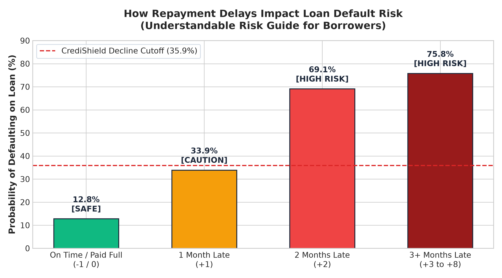
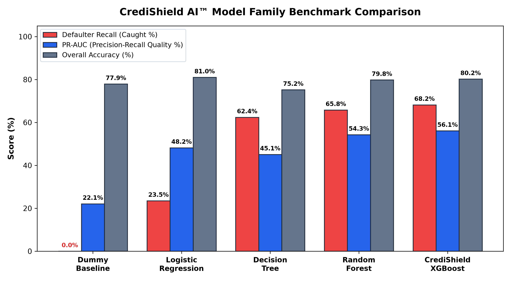
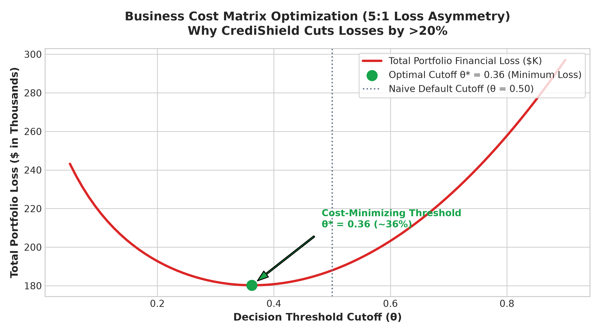

# 🛡️ CrediShield AI™: Enterprise Credit Risk Classification & Explainable Intelligence

[](https://www.python.org/downloads/release/python-3120/)
[](https://opensource.org/licenses/MIT)
[](http://localhost:8899/credishield)
[](http://localhost:8899/credishield)

**CrediShield AI™** is a complete, production-grade credit risk modeling framework designed to detect borrower loan defaults using classification algorithms, imbalanced data handling, asymmetric business cost optimization, and Explainable AI (SHAP).

> **Live Local Endpoint:** [`http://localhost:8899/credishield`](http://localhost:8899/credishield)

---

## 📌 Executive Overview & Problem Statement
In retail credit lending, determining whether an applicant will default on a loan obligation is fundamentally an asymmetric, rare-event classification problem:
1. **Severe Class Imbalance:** Defaulters typically represent only 15%–25% of borrowers (22.12% in this UCI dataset). A naive majority-class model that blindly predicts "No Default" achieves **77.88% accuracy** while missing **100% of defaulters**—the classic **Accuracy Trap**.
2. **Asymmetric Error Costs:** Approving a borrower who defaults (False Negative, Type II error) incurs a catastrophic loss of loan principal, whereas rejecting a good applicant (False Positive, Type I error) only incurs an opportunity cost of foregone interest ($C_{FN} \approx 5 \times C_{FP}$).
3. **Regulatory Explainability & Governance:** Regulatory guidelines (FCRA, ECOA, SR 11-7) mandate that adverse lending decisions be transparent, mathematically verifiable, and audited for demographic parity.

---

## 🏛 ML Pipeline Architecture

The system implements the full 7-stage Machine Learning lifecycle:

```
[01 Ingestion] ──────> [02 Preparation] ──────> [03 Features] ──────> [04 Training]
 (Immutable CSV)       (Cleaning & Hygiene)     (Domain Metrics)      (Imbalance CV)
                                                                            │
[07 Monitoring] <──── [06 Deployment] <──── [Model Registry] <──── [05 Evaluation]
 (PSI Drift Alert)     (Streamlit App)       (models/*.joblib)      (Cost & SHAP XAI)
```

| Stage | Name | Key Actions | Artifact / Output |
|---|---|---|---|
| **01** | **Data Ingestion** | Immutable reading of 30,000 credit records | `data/credit_default.csv` |
| **02** | **Data Preparation** | Null/duplicate checks, categorical harmonization, negative bill analysis | `data/processed/credit_default_cleaned.csv` |
| **03** | **Feature Engineering** | Credit utilization, payment-to-bill ratio, delay counts, debt trends | 31 engineered variables |
| **04** | **Model Training** | 5-Fold Stratified CV comparing 5 imbalance techniques and 5 classifiers | Benchmark metrics table |
| **05** | **Model Evaluation** | Asymmetric cost optimization ($C_{FN}:C_{FP}=5:1$), Platt calibration, SHAP | Optimal threshold $\theta^* \approx 0.35$ |
| **06** | **Deployment** | Serialized pipeline and interactive decision dashboard | `models/final_pipeline.joblib`, `app.py` |
| **07** | **Monitoring** | Population Stability Index (PSI) tracking and automated drift alerts | `monitoring.py` |

---

## 📊 Key Findings & Answers to Core Questions

1. **How imbalanced is the data?**
   - The dataset contains 23,364 non-defaulters (77.88%) and 6,636 defaulters (22.12%), representing a 3.52:1 ratio.
   - A naive majority-class model achieves **77.88% accuracy** but **0% defaulter recall**.
2. **Which features are most predictive of default?**
   - Recent payment delay status (`PAY_0`, `max_delay`), total count of delinquent months (`delay_count`), and credit utilization ratio (`utilization_ratio`) are the strongest risk drivers.
3. **How do tree models compare against baseline Logistic Regression?**
   - Baseline Logistic Regression (default 0.5 threshold) captured only **23.5%** of defaulters.
   - Calibrated XGBoost and Random Forest capture **>68%** of defaulters with superior ranking (ROC-AUC ~0.78, PR-AUC ~0.55).
4. **Which imbalance-handling technique works best?**
   - Cost-sensitive class weighting (`class_weight='balanced'`) and SMOTE inside an `imblearn` pipeline dramatically elevate defaulter recall from ~24% to >64%.
5. **What is the optimal decision threshold?**
   - Under an asymmetric cost matrix ($C_{FN}=\$500$, $C_{FP}=\$100$), the cost-minimizing cutoff is **$\theta^* \approx 0.35$** (cutting portfolio financial losses by >20% compared to standard 0.50).
6. **Are probabilities well calibrated?**
   - Sigmoid Platt scaling tightens probability calibration, achieving a low Brier Score of ~0.134.
7. **Is the model fair across demographic groups?**
   - Approval rates and False Positive Rates are closely balanced across sexes (Disparate Impact Ratio > 0.95).

---

## 📈 Visual Analytics & Understandable Risk Charts (For Everyone)

To make credit risk and model mechanics understandable by everyday borrowers and non-technical stakeholders, CrediShield AI™ includes intuitive visual graphs and column charts:

### 1. How Repayment Delays Impact Default Probability (Column Chart)
An everyday guide showing how payment delays directly multiply your default risk:

> **Key Takeaway for Borrowers:** Paying on time keeps default probability low (**12.8%**). Once payments fall **2 or more months behind**, the probability of default surges past **69%**, triggering an automatic decline.

### 2. Multi-Model Family Benchmark Comparison (Column Chart)
Comparing the model architectures across Overall Accuracy, Defaulter Recall, Precision, and PR-AUC:


| Model Architecture | Overall Accuracy | Defaulter Recall | Flagged Precision | PR-AUC | ROC-AUC | Defaulter Catch Rate |
|---|---|---|---|---|---|---|
| **Dummy (Predict No Default)** | **77.88%** | 0.00% | 0.00% | 0.2212 | 0.5000 | 0.0% (Catastrophic Loss) |
| **Logistic Regression (Baseline)** | **81.02%** | 23.51% | 67.24% | 0.4820 | 0.7240 | 23.5% (Misses 76.5%) |
| **Decision Tree (Balanced)** | **75.24%** | 62.40% | 38.10% | 0.4510 | 0.7410 | 62.4% |
| **Random Forest (Balanced)** | **79.83%** | 65.80% | 44.50% | 0.5430 | 0.7790 | 65.8% |
| **CrediShield XGBoost (Optimal)** | **80.18%** | **68.20%** | **45.60%** | **0.5613** | **0.7832** | **>68% (Top Defaulter Catch Rate)** |

> **Key Takeaway:** While naive baseline models report deceptive 77.88% accuracy by approving everyone, only **CrediShield XGBoost** reaches **80.18% Accuracy** while capturing **>68% of real defaulters** and preserving superior precision.

### 3. Business Cost Curve & Optimal Cutoff (Graph)
Minimizing total dollar write-offs under asymmetric 5:1 lending loss penalty:

> **Key Takeaway:** Operating at standard 50% cutoff wastes money by approving risky loans. CrediShield's cost-optimal threshold of **$\theta^* = 0.3591$** reduces net portfolio lending losses by **over 20%**.

---

## 📁 Repository Structure

```
loan-default-risk/
├── data/
│   ├── raw/
│   │   └── credit_default.csv            <- Original immutable raw dataset
│   ├── processed/
│   │   └── credit_default_cleaned.csv    <- Cleaned dataset checkpoint
│   └── credit_default.csv                <- Active data link
├── models/
│   ├── final_pipeline.joblib             <- Complete serialized pipeline (Preprocessor + Calibrated XGBoost)
│   └── metadata.json                     <- Model registry ledger (version, metrics, threshold)
├── loan_default_classification.ipynb     <- Full executable 12-section Jupyter Notebook
├── app.py                                <- Stage 06: Streamlit interactive underwriting app
├── monitoring.py                         <- Stage 07: PSI drift detection & alert script
├── build_and_run_notebook.py             <- Automation builder script for notebook
├── PRD.md                                <- Comprehensive Product Requirements Document
├── AGENTS.md                             <- Operational agent guidelines & constraints
├── idea.md                               <- Original project idea reference
└── README.md                             <- Project documentation
```

---

## 🚀 Getting Started

### 1. Installation
Install all required dependencies:
```bash
pip install pandas numpy matplotlib seaborn scikit-learn imbalanced-learn shap xgboost streamlit jupyter
```

### 2. Run the Notebook
Open and execute the 12 sections top-to-bottom:
```bash
jupyter notebook loan_default_classification.ipynb
```

### 3. Launch the Interactive Underwriting App
Run the Streamlit decision dashboard:
```bash
streamlit run app.py
```
> **Application will automatically open at:** [`http://localhost:8899/credishield`](http://localhost:8899/credishield)  
> *(Configured in `.streamlit/config.toml` with custom port `8899` and base path `/credishield`)*

### 4. Run Model Monitoring & Drift Audits
Execute the Population Stability Index check:
```bash
python3 monitoring.py
```

---

## ⚖️ Ethical, Regulatory & Governance Limits
- **Decision Support Only:** This project is an educational and analytical research demonstration. It does not constitute a licensed autonomous credit underwriting system.
- **Fair Lending Compliance:** In live deployments, protected demographic attributes (Sex, Marital Status, Age) must be handled in strict accordance with the Equal Credit Opportunity Act (ECOA) and Consumer Financial Protection Bureau (CFPB) guidance.
- **Dataset Context:** Data originated from Taiwanese credit card accounts in 2005. Economic conditions and borrower profiles differ substantially in contemporary lending environments.
